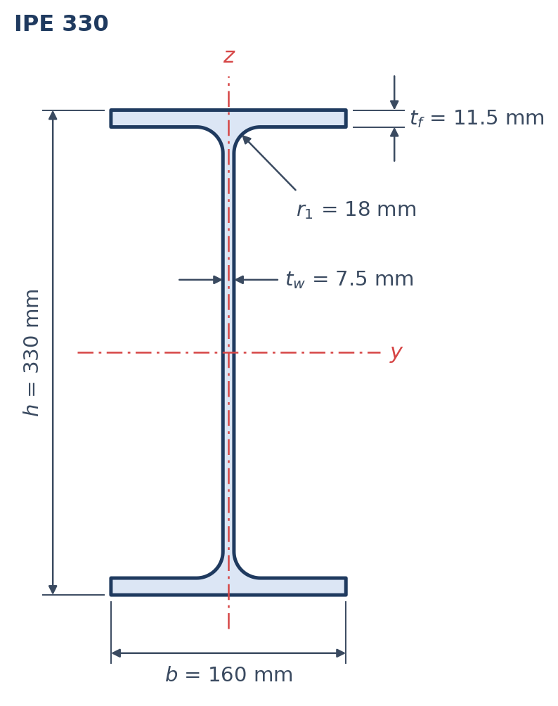
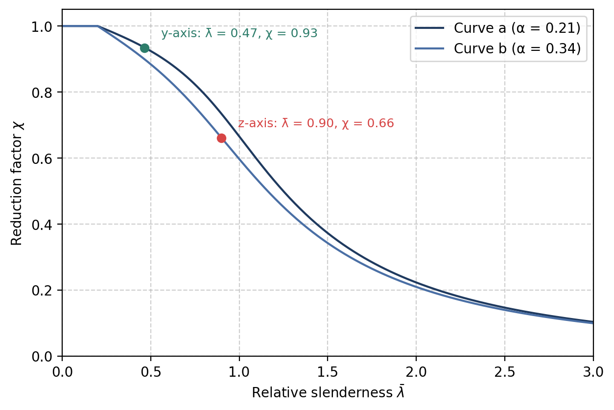

# Flexural buckling of an IPE 330 column

How much axial force can an IPE 330 column carry if it buckles about its weak axis? A short
worked example with the numbers shown.

<!-- more -->

## The section

<figure markdown="span">
  { width="360" }
  <figcaption>Figure 1: IPE 330 with its dimensions. The y-axis is the strong axis.</figcaption>
</figure>

The area is $A = 62.6$ cm² and the radii of gyration are $i_y = 137$ mm and $i_z = 35.5$ mm.
The steel is S235 ($f_y = 235$ N/mm²) and $\gamma_{M1} = 1.0$.

## Relative slenderness

With the squash load $N_{pl} = A f_y = 1471.1$ kN and $\lambda_1 = 93.91$:

$$
\bar{\lambda}_y = \frac{6000/137}{93.91} = 0.466
\qquad
\bar{\lambda}_z = \frac{3000/35.5}{93.91} = 0.900
$$

## Reduction factor and resistance

<figure markdown="span">
  { width="640" }
  <figcaption>Figure 2: Buckling curves a and b. The two points are the result of this example.</figcaption>
</figure>

| Axis | Curve | $\bar{\lambda}$ | $\chi$ | $N_{b,Rd}$ [kN] |
|---|---|---|---|---|
| y (6 m) | a | 0.466 | 0.934 | 1374.6 |
| z (3 m) | b | 0.900 | 0.661 | 972.8 |

!!! success "Result"
    The weak axis governs. The column can carry $N_{b,Rd} = 972.8$ kN, which is **66 %** of the
    squash load.

## Take-away

A short buckling length about the weak axis matters more than the strong-axis length: here half
the length about z still gives the lower resistance.

The full derivation is in the chapter [Flexural buckling](../../book/03-buckling.md).
