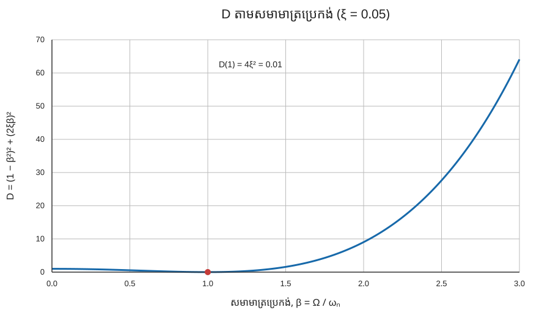
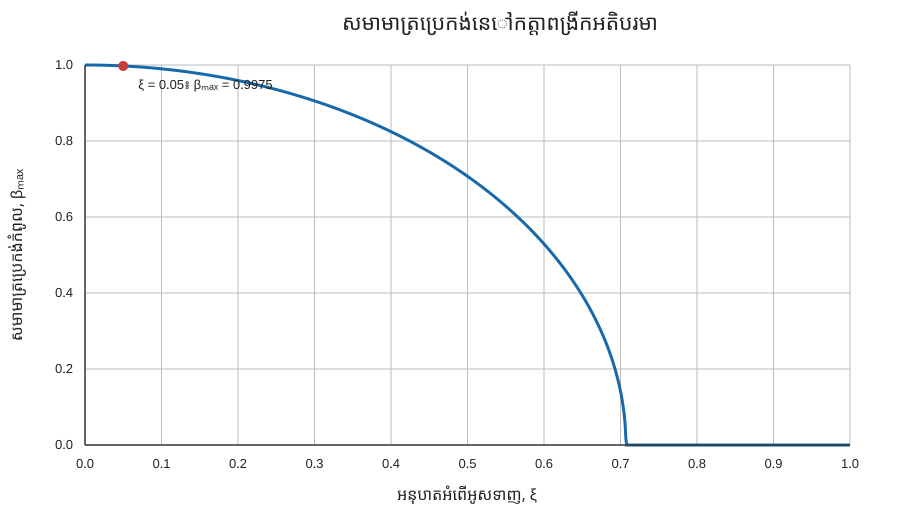
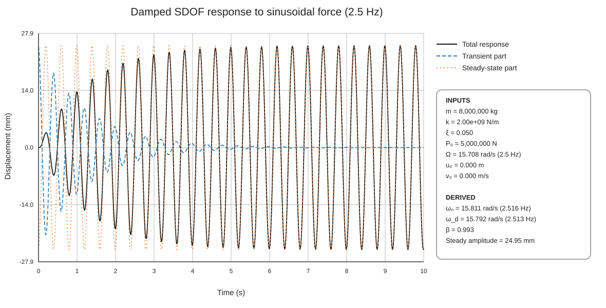
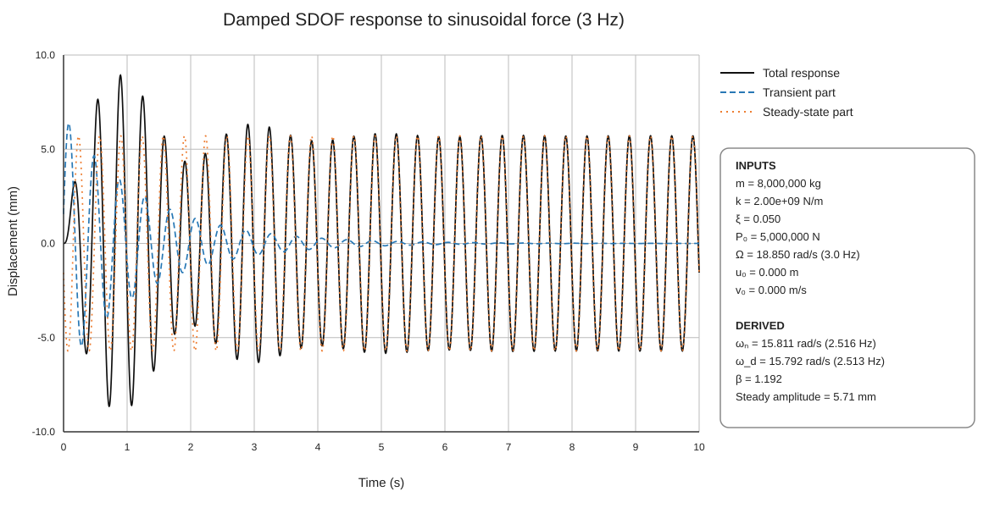
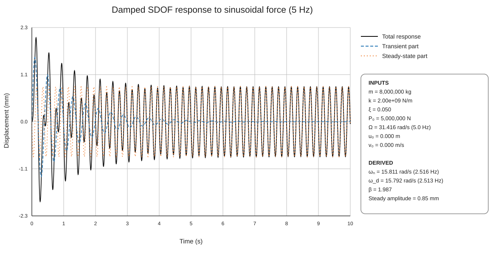

# ចម្លើយអាម៉ូនិកដោយបង្ខំរបស់ប្រព័ន្ធ SDOF មានអំពើអូសទាញ

## សេចក្តីសង្ខេប

អត្ថបទនេះសិក្សាចម្លើយរបស់ប្រព័ន្ធលីនេអ៊ែរ មានអំពើអូសទាញ និងមានមួយដឺក្រេសេរីភាព (SDOF) ក្រោមកម្លាំងស៊ីនុយសូអ៊ីត។ ចម្លើយត្រូវបានបែងចែកជាផ្នែកបណ្ដោះអាសន្ន ដែលថយចុះដោយសារអំពើអូសទាញ និងផ្នែកស្ថិរភាព ដែលបន្តយោលតាមប្រេកង់កម្លាំង។ ប្រើម៉ាស 8,000 តោន ភាពរឹង $2.0\times10^9$ N/m អនុបាតអូសទាញ $\xi=0.05$ និងអំព្លីទុតកម្លាំង 5,000 kN ដើម្បីវាយតម្លៃប្រេកង់បង្ខំ 2.5, 3.0 និង 5.0 Hz។ ក្រាបបង្ហាញឥទ្ធិពលនៃសមាមាត្រប្រេកង់លើការបង្កើនឌីណាមិច និងប្រៀបធៀបចម្លើយនៅដំណាក់កាលចាប់ផ្ដើមជាមួយចម្លើយតាមវដ្តរយៈពេលវែង។

<!-- more -->

## ជំពូកទី 1 — គំរូ ទិន្នន័យបញ្ចូល និងចម្លើយ

### 1.1 សមីការចលនា

ប្រព័ន្ធត្រូវបានតំណាងដោយសមីការ

$$
m\ddot{u}(t)+c\dot{u}(t)+ku(t)=P_0\sin(\Omega t),
$$

ដែល $u(t)$ ជាការផ្លាស់ទី $m$ ជាម៉ាស $c$ ជាមេគុណអំពើអូសទាញស្អិត $k$ ជាភាពរឹង $P_0$ ជាអំព្លីទុតកម្លាំង និង $\Omega$ ជាប្រេកង់មុំរបស់កម្លាំងបង្ខំ។ អនុបាតអូសទាញគឺ $\xi=c/(2m\omega_n)$។

តម្លៃដែលបានផ្ដល់មាន៖

| បរិមាណ | សញ្ញា | តម្លៃ |
|---|---:|---:|
| ម៉ាស | $m$ | 8,000,000 kg |
| ភាពរឹង | $k$ | $2.0\times10^9$ N/m |
| អនុបាតអូសទាញ | $\xi$ | 0.05 |
| អំព្លីទុតកម្លាំង | $P_0$ | 5,000,000 N |
| ការផ្លាស់ទីដំបូង | $u_0$ | 0 m |
| ល្បឿនដំបូង | $v_0$ | 0 m/s |
| ប្រេកង់បង្ខំ | $f=\Omega/(2\pi)$ | 2.5, 3.0 និង 5.0 Hz |

ប្រេកង់ធម្មជាតិមិនមានអំពើអូសទាញ និងប្រេកង់ធម្មជាតិមានអំពើអូសទាញគឺ

$$
\omega_n=\sqrt{\frac{k}{m}}=15.811\ \mathrm{rad/s}=2.516\ \mathrm{Hz},
\qquad
\omega_d=\omega_n\sqrt{1-\xi^2}=15.792\ \mathrm{rad/s}=2.513\ \mathrm{Hz}.
$$

### 1.2 ផ្នែកបណ្ដោះអាសន្ន និងផ្នែកស្ថិរភាព

ចម្លើយសរុបគឺផលបូករវាងចម្លើយបណ្ដោះអាសន្ន និងចម្លើយស្ថិរភាពក្រោមកម្លាំងបង្ខំ៖

$$
u(t)=u_{\mathrm{tr}}(t)+u_{\mathrm{ss}}(t).
$$

សម្រាប់ប្រព័ន្ធអូសទាញក្រោមកម្រិត ផ្នែកបណ្ដោះអាសន្នមានទម្រង់

$$
u_{\mathrm{tr}}(t)=e^{-\xi\omega_n t}\left[B_1\cos(\omega_d t)+B_2\sin(\omega_d t)\right].
$$

សមីការនេះក៏ជាចម្លើយទូទៅនៃសមីការឌីផេរ៉ង់ស្យែលធម្មតាឯកសណ្ឋានសម្រាប់ចលនាសេរីផងដែរ។ មេគុណ $B_1$ និង $B_2$ កំណត់ដោយការផ្លាស់ទីដំបូង ល្បឿនដំបូង លក្ខណៈធម្មជាតិរបស់ប្រព័ន្ធ និងបន្ទុកខាងក្រៅ។ តាមសញ្ញាសម្គាល់ក្នុងសមីការដែលបានផ្ដល់ កំណត់

$$
\beta=\frac{\Omega}{\omega_n},\qquad
D=(1-\beta^2)^2+(2\xi\beta)^2.
$$

មេគុណបណ្ដោះអាសន្នគឺ

$$
B_1=u_0+\frac{2\xi\beta}{D}\frac{P_0}{k},\qquad
B_2=\frac{v_0+\xi\omega_n B_1}{\omega_d}
-\frac{(1-\beta^2)\Omega}{\omega_dD}\frac{P_0}{k}.
$$

ចម្លើយស្ថិរភាពគឺ

$$
u_{\mathrm{ss}}(t)=\frac{P_0}{k\sqrt D}\sin(\Omega t-\phi),
$$

ដែលមុំផាសកំណត់ដោយ

$$
\cos\phi=\frac{1-\beta^2}{\sqrt D},\qquad
\sin\phi=\frac{2\xi\beta}{\sqrt D},\qquad
\tan\phi=\frac{2\xi\beta}{1-\beta^2}.
$$

 អំព្លីទុតការផ្លាស់ទីស្ថិរភាពគឺ $P_0/(k\sqrt D)$ ហើយមិនអាស្រ័យលើលក្ខខណ្ឌដំបូងទេ។ ផ្នែកបណ្ដោះអាសន្នធានាថាចម្លើយសរុបបំពេញតាមលក្ខខណ្ឌដំបូងដែលបានកំណត់។

## ជំពូកទី 2 — រូបទី 1៖ កត្តាពង្រីកថាមវន្តតាមសមាមាត្រប្រេកង់

រូបទី 1 បង្ហាញកត្តាពង្រីកថាមវន្ត $A$ ក្នុងចន្លោះ $0\leq\beta\leq3$ សម្រាប់ $\xi=0.05$ ដែល

$$
A(\xi,\beta)=\frac{1}{\sqrt{(1-\beta^2)^2+(2\xi\beta)^2}}
$$

អំព្លីទុតចម្លើយលំនឹងស្ថិរគឺ

$$
u_{\mathrm{ss,amp}}=\frac{P_0}{k}A
=\underbrace{\frac{P_0}{k}}_{\text{ការផ្លាស់ទីឋិតិវន្ត}}\,
\underbrace{A}_{\text{កត្តាពង្រីកថាមវន្ត}}
$$

ដូច្នេះ $P_0/k$ គឺជាការផ្លាស់ទីឋិតិវន្តក្រោមកម្លាំងថេរទំហំ $P_0$ ខណៈ $A$ ជាកត្តាគុណសម្រាប់ទទួលបានអំព្លីទុតលំនឹងស្ថិរចំពោះកម្លាំងស៊ីនុយសូអ៊ីត។ សម្រាប់ទិន្នន័យបញ្ចូលក្នុងអត្ថបទនេះ $P_0/k=0.0025$ m (2.5 mm)។

នៅ $\beta=0$ កត្តាពង្រីកស្មើ 1។ សម្រាប់អំពើអូសទាញមិនសូន្យ កំពូលជាទូទៅកើតឡើងនៅតម្លៃ $\beta$ ទាបជាង 1 បន្តិច។ ដោយដាក់ $dA/d\beta=0$ បាន៖

$$
\beta_{\max}=\sqrt{1-2\xi^2}, \qquad 0<\xi<\frac{1}{\sqrt{2}}.
$$

សម្រាប់ $\xi=0.05$ មាន $\beta_{\max}=0.9975$ និង $A_{\max}=1/(2\xi\sqrt{1-\xi^2})=10.0125$។ នៅ $\beta=1$ ពិតប្រាកដ មាន $A=1/(2\xi)=10$ ដែលជិតនឹងតម្លៃអតិបរមា ប៉ុន្តែតូចជាងបន្តិចសម្រាប់អនុបាតអំពើអូសទាញនេះ។ នៅពេលប្រេកង់រំញោចខ្ពស់ជាងតម្លៃកំពូល $A$ ថយចុះ ហើយអំព្លីទុតចម្លើយស្ថិរតូចជាងបើប្រៀបធៀបនឹងការផ្លាស់ទីឋិតិវន្ត។

### សមាមាត្រប្រេកង់កំពូលតាមអនុបាតអំពើអូសទាញ

រូបទី 1b បង្ហាញសមាមាត្រប្រេកង់ដែលធ្វើឱ្យ $A$ មានតម្លៃអតិបរមា តាមការប្រែប្រួលអនុបាតអំពើអូសទាញ។ លក្ខខណ្ឌ $dA/d\beta=0$ ផ្ដល់ $\beta_{\max}=\sqrt{1-2\xi^2}$ នៅពេល $0<\xi<1/\sqrt{2}$។ កំពូលផ្លាស់ទៅសមាមាត្រប្រេកង់ទាប នៅពេលអំពើអូសទាញកើនឡើង។ ចំណុចសម្រាប់ប្រព័ន្ធនេះដែលមាន $\xi=0.05$ ត្រូវបានសម្គាល់លើក្រាប។ នៅពេលអំពើអូសទាញសូន្យ ចម្លើយមិនមានដែនកំណត់នៅ $\beta=1$។ នៅពេល $\xi\geq1/\sqrt{2}$ កំពូលលើជួរសមាមាត្រប្រេកង់មិនអវិជ្ជមានកើតនៅ $\beta=0$។

សមាមាត្រប្រេកង់សម្រាប់ប្រេកង់បង្ខំទាំងបីប្រហែល 0.994, 1.193 និង 1.988 តាមលំដាប់។ បន្ទុក 2.5 Hz ជិតនឹងប្រេកង់ធម្មជាតិបំផុត ខណៈបន្ទុក 5.0 Hz ជិតពីរដងនៃប្រេកង់ធម្មជាតិ។

## ជំពូកទី 3 — រូបទី 2៖ ចម្លើយនៅ 2.5 Hz

សម្រាប់ $f=2.5$ Hz មាន $\Omega=15.708$ rad/s និង $\beta\approx0.994$។ ប្រេកង់បង្ខំទាបជាងប្រេកង់ធម្មជាតិតែបន្តិច។ អំព្លីទុតការផ្លាស់ទីស្ថិរភាពប្រហែល 25 mm ដែលធំបំផុតក្នុងចំណោមករណីទាំងបី។

នៅពេលកម្លាំងចាប់ផ្ដើម ចម្លើយស្ថិរភាពតែមួយមុខជាទូទៅមិនបំពេញលក្ខខណ្ឌដំបូងទេ។ ផ្នែកបណ្ដោះអាសន្នបន្ថែមដើម្បីប៉ះប៉ូវការផ្លាស់ទី និងល្បឿនរបស់ចម្លើយស្ថិរភាពនៅ $t=0$ ដូច្នេះចម្លើយសរុបចាប់ផ្ដើមពីស្ថានភាពស្ងៀម។ បន្ទាប់មកការយោលបណ្ដោះអាសន្នថយចុះតាមស្រោមអិចស្ប៉ូណង់ស្យែល $e^{-\xi\omega_n t}$។ នៅពេលផ្នែកនេះតូចទៅ ចម្លើយសរុបចូលទៅជិតការយោលស្ថិរភាពនៅ 2.5 Hz។

ចម្លើយដំបូងអាចខុសពីអំព្លីទុតចុងក្រោយយ៉ាងច្រើន ព្រោះផ្នែកបណ្ដោះអាសន្ន និងស្ថិរភាពត្រូវបានបូកបញ្ចូលគ្នា។ ផាសធៀបរបស់វាកំណត់ថាតើវាបន្ថែមគ្នា ឬប៉ះប៉ូវគ្នាខ្លះៗនៅពេលនីមួយៗ។

## ជំពូកទី 4 — រូបទី 3៖ ចម្លើយនៅ 3.0 Hz

សម្រាប់ $f=3.0$ Hz មាន $\Omega=18.850$ rad/s និង $\beta\approx1.193$។ ប្រេកង់នេះខ្ពស់ជាងប្រេកង់ធម្មជាតិ ប៉ុន្តែនៅជិតគ្នាគួរសម។ អំព្លីទុតការផ្លាស់ទីស្ថិរភាពប្រហែល 5.7 mm តិចជាងមួយភាគបួននៃករណី 2.5 Hz។

ចម្លើយសរុបចាប់ផ្ដើមពីសូន្យ ហើយមានការផ្លាស់ទីដំបូងធំជាង នៅពេលផ្នែកបណ្ដោះអាសន្ននៅតែមានឥទ្ធិពល។ តាមពេលវេលា ផ្នែកបណ្ដោះអាសន្នថយចុះ ហើយចម្លើយសរុបចូលទៅជិតខ្សែស្ថិរភាពនៅ 3.0 Hz។ ការប្រៀបធៀបជាមួយរូបទី 2 បង្ហាញថា ការប្រែប្រួលប្រេកង់ត្រឹម 0.5 Hz មានឥទ្ធិពលខ្លាំង ព្រោះវាធ្វើឱ្យប្រព័ន្ធផ្លាស់ចេញពីសមាមាត្រប្រេកង់ដែលមានការបង្កើនខ្លាំងបំផុត។

ការផ្លាស់ទីកំពូលនៅដំណាក់កាលចាប់ផ្ដើមមិនអាស្រ័យលើអំព្លីទុតស្ថិរភាពតែមួយទេ។ វាអាស្រ័យលើអំព្លីទុត និងផាសនៃផ្នែកបណ្ដោះអាសន្ន ដែលក្នុងករណីនេះកំណត់ដោយការផ្លាស់ទី និងល្បឿនដំបូងសូន្យ។

## ជំពូកទី 5 — រូបទី 4៖ ចម្លើយនៅ 5.0 Hz

សម្រាប់ $f=5.0$ Hz មាន $\Omega=31.416$ rad/s និង $\beta\approx1.988$។ ប្រេកង់បង្ខំខ្ពស់ជាងប្រេកង់ធម្មជាតិច្រើន។ អំព្លីទុតការផ្លាស់ទីស្ថិរភាពប្រហែល 0.84 mm ដែលតូចបំផុតក្នុងចំណោមករណីទាំងបី។

ចម្លើយនៅដំណាក់កាលដំបូងនៅតែមានផ្នែកបណ្ដោះអាសន្ន ហើយចម្លើយសរុបអាចមានកំពូលលើសអំព្លីទុតស្ថិរភាពខ្លះៗ នៅពេលផ្នែកទាំងពីរបូកគ្នា។ ផ្នែកបណ្ដោះអាសន្ននឹងថយចុះ ហើយនៅសល់តែការយោលតូចជាងនៅប្រេកង់កម្លាំង។ លទ្ធផលស្របនឹងរូបទី 1៖ នៅសមាមាត្រប្រេកង់ខ្ពស់នេះ កត្តាពង្រីកថាមវន្ត $A$ តូចជាងក្បែរ $\beta_{\max}$ ច្រើន ដូច្នេះអំព្លីទុតស្ថិរភាព $(P_0/k)A$ ក៏តូចជាងដែរ។

## ជំពូកទី 6 — ការពិភាក្សា

លទ្ធផលបែងចែកឥរិយាបថពេលចាប់ផ្ដើមចេញពីចលនាបង្ខំរយៈពេលវែង។ ពាក្យបណ្ដោះអាសន្នយោលជាចម្បងតាមប្រេកង់ធម្មជាតិមានអំពើអូសទាញ ហើយថយចុះតាមស្រោមអំពើអូសទាញ។ ពាក្យស្ថិរភាពយោលតាមប្រេកង់កម្លាំងដែលដាក់ ហើយបន្តមានដរាបណាកម្លាំងស៊ីនុយសូអ៊ីតនៅតែបន្ត។

អំព្លីទុតស្ថិរភាពសម្រាប់ករណីទាំងបីថយចុះ នៅពេលប្រេកង់បង្ខំឆ្ងាយពីប្រេកង់រេសូណង់៖

| ប្រេកង់បង្ខំ | សមាមាត្រប្រេកង់ $\beta$ | អំព្លីទុតស្ថិរភាព |
|---:|---:|---:|
| 2.5 Hz | 0.994 | ប្រហែល 25 mm |
| 3.0 Hz | 1.193 | ប្រហែល 5.7 mm |
| 5.0 Hz | 1.988 | ប្រហែល 0.84 mm |

តម្លៃទាំងនេះគណនាពីកម្លាំង និងប៉ារ៉ាម៉ែត្រប្រព័ន្ធដែលបានផ្ដល់។ វាបង្ហាញពីការពឹងផ្អែកលើប្រេកង់របស់ប្រព័ន្ធ SDOF លីនេអ៊ែរ មិនមែនការផ្លាស់ប្ដូរអំព្លីទុតកម្លាំងទេ៖ អំព្លីទុតកម្លាំងនៅតែ 5 MN សម្រាប់គ្រប់ករណី។ ចម្លើយស្ថិរភាពធំបំផុតកើតនៅ 2.5 Hz ព្រោះប្រេកង់បង្ខំជិតប្រេកង់ធម្មជាតិបំផុត។

ក្រាបចម្លើយគួរបង្ហាញថាការផ្លាស់ទីសរុបស្មើផលបូកនៃផ្នែកពីរផ្សេងទៀត។ នេះជាវិធីពិនិត្យសមីការ និងកូដ។ រូបភាពដែលបង្កើតឡើងវិញក្នុងអត្ថបទនេះប្រើសមីការដូចគ្នាសម្រាប់សមាសភាគទាំងបី បំពេញលក្ខខណ្ឌដំបូងនៅ $t=0$ ហើយដាក់ប្រអប់ទិន្នន័យនៅខាងក្រៅអ័ក្សគំនូស ដើម្បីកុំឱ្យគ្របខ្សែក្រាប។

### វិសាលភាព និងសន្មត់

គំរូនេះសន្មតថាភាពរឹងលីនេអ៊ែរ អំពើអូសទាញស្អិត លក្ខណៈប្រព័ន្ធថេរ និងមានមួយដឺក្រេសេរីភាព។ វាក៏សន្មតថាបន្ទុកស៊ីនុយសូអ៊ីតបន្តចាប់ពី $t=0$។ រចនាសម្ព័ន្ធពិតអាចមានមូដរំញ័រច្រើន ចម្លើយមិនលីនេអ៊ែរ អំពើអូសទាញប្រែប្រួល ឬបន្ទុកដែលអំព្លីទុត និងប្រេកង់ប្រែប្រួល។ បាតុភូតទាំងនេះមិនស្ថិតក្នុងការគណនានេះទេ។

## ជំពូកទី 7 — សេចក្តីសន្និដ្ឋាន

1. ប្រព័ន្ធមានប្រេកង់ធម្មជាតិមិនមានអំពើអូសទាញប្រហែល 2.516 Hz និងប្រេកង់ធម្មជាតិមានអំពើអូសទាញប្រហែល 2.513 Hz។
2. សម្រាប់ $0<\xi<1/\sqrt{2}$ កំពូលកើតនៅ $\beta_{\max}=\sqrt{1-2\xi^2}$។ សម្រាប់ $\xi=0.05$ មាន $\beta_{\max}=0.9975$ និង $A_{\max}=10.0125$។
3. ក្នុងចំណោមប្រេកង់បង្ខំទាំងបី ករណី 2.5 Hz ផ្ដល់ការផ្លាស់ទីស្ថិរភាពធំបំផុត (ប្រហែល 25 mm) បន្ទាប់មក 3.0 Hz (ប្រហែល 5.7 mm) និង 5.0 Hz (ប្រហែល 0.84 mm)។
4. ចម្លើយបណ្ដោះអាសន្នមានសារៈសំខាន់នៅពេលចាប់ផ្ដើមបន្ទុក ប៉ុន្តែវាថយចុះតាមពេលវេលា។ បន្ទាប់ពីវាថយចុះគ្រប់គ្រាន់ ចម្លើយសរុបត្រូវបានគ្រប់គ្រងដោយការយោលស្ថិរភាពនៅប្រេកង់កម្លាំង។
5. ការផ្លាស់ទីកំពូលពេលចាប់ផ្ដើមអាចលើសអំព្លីទុតស្ថិរភាព ព្រោះផ្នែកបណ្ដោះអាសន្ន និងស្ថិរភាពបូកបញ្ចូលគ្នាតាមផាសរបស់វា។

## ជំពូកទី 8 — អនុសាសន៍សម្រាប់ការសិក្សានាពេលអនាគត

- **បង្កើនដង់ស៊ីតេការវិភាគប្រេកង់ក្បែរ​រេសូណង់។** គណនាអំព្លីទុតស្ថិរភាពក្នុងជួរប្រេកង់ដិតជុំវិញ 2.516 Hz ហើយគូសខ្សែកោងរេសូណង់ ដើម្បីកំណត់កំពូលឱ្យបានច្បាស់។
- **ប្ដូរអនុបាតអូសទាញ។** ប្រៀបធៀបខ្សែកោងចម្លើយ និងការថយចុះនៃចម្លើយបណ្ដោះអាសន្ន សម្រាប់តម្លៃ $\xi$ ខុសៗគ្នា ដើម្បីវាយតម្លៃឥទ្ធិពលលើកំពូលចម្លើយ និងពេលស្ងប់។
- **រាយការណ៍សូចនាករចម្លើយ។** សម្រាប់ករណីនីមួយៗ តារាងអំព្លីទុតស្ថិរភាព ការផ្លាស់ទីសរុបដាច់ខាតអតិបរមា និងពេលវេលាដែលស្រោមបណ្ដោះអាសន្នធ្លាក់ក្រោមកម្រិតកំណត់។
- **សិក្សាលក្ខខណ្ឌដំបូងផ្សេងៗ។** តម្លៃ $u_0$ និង $v_0$ មិនសូន្យនឹងផ្លាស់ប្ដូរចម្លើយបណ្ដោះអាសន្ន ប៉ុន្តែអំព្លីទុតស្ថិរភាពនៅដដែលសម្រាប់កម្លាំង និងលក្ខណៈប្រព័ន្ធដូចគ្នា។
- **ពិនិត្យប្រវត្តិបន្ទុកផ្សេងៗ។** ប្រៀបធៀបបន្ទុកអាម៉ូនិកជាមួយបន្ទុកជីពចរ បន្ទុកច្រើនប្រេកង់ និងប្រវត្តិរំញ័រដែលបានកត់ត្រា។
- **ពង្រីកគំរូរចនាសម្ព័ន្ធ។** នៅពេលចាំបាច់ សិក្សាឥរិយាបថច្រើនដឺក្រេសេរីភាព ភាពរឹងមិនលីនេអ៊ែរ និងគំរូអំពើអូសទាញដែលសមស្របជាង។

