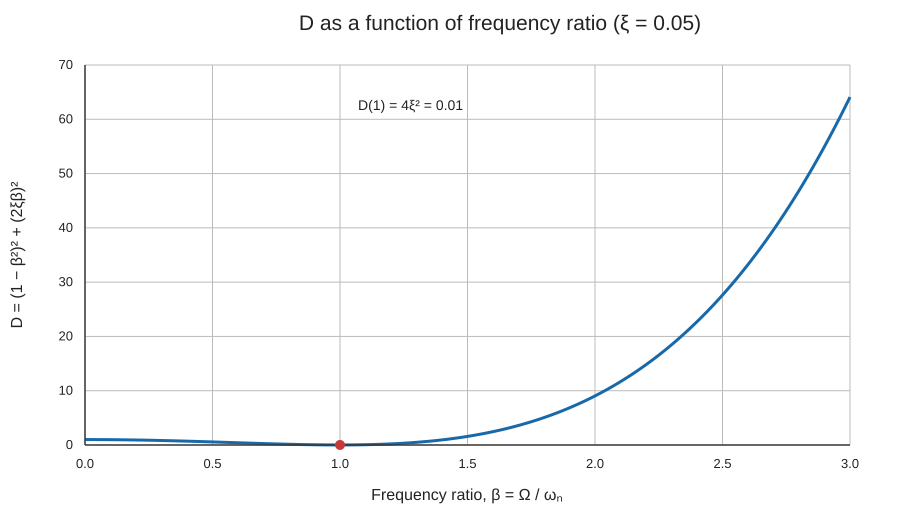

# Forced harmonic response of a damped SDOF system

## Abstract

This article examines the response of a linear, damped, single-degree-of-freedom (SDOF) system to a sinusoidal force. The response is separated into a transient part, which decays because of damping, and a steady-state part, which continues at the forcing frequency. Using a mass of 8,000 tonnes, stiffness of 2.0 × 10⁹ N/m, damping ratio ξ = 0.05, and force amplitude of 5,000 kN, the response is evaluated for excitation frequencies of 2.5, 3.0, and 5.0 Hz. The plots show the effect of frequency ratio on dynamic amplification and compare the start-up response with the long-term periodic response.

<!-- more -->

## Chapter 1 — Model, inputs, and solution

### 1.1 Equation of motion

The system is represented by the equation

$$
m\ddot{u}(t)+c\dot{u}(t)+ku(t)=P_0\sin(\Omega t),
$$

where $u(t)$ is displacement, $m$ is mass, $c$ is the viscous damping coefficient, $k$ is stiffness, $P_0$ is the force amplitude, and $\Omega$ is the forcing circular frequency. The damping ratio is $\xi=c/(2m\omega_n)$.

The supplied values are:

| Quantity | Symbol | Value |
|---|---:|---:|
| Mass | $m$ | 8,000,000 kg |
| Stiffness | $k$ | $2.0\times10^9$ N/m |
| Damping ratio | $\xi$ | 0.05 |
| Force amplitude | $P_0$ | 5,000,000 N |
| Initial displacement | $u_0$ | 0 m |
| Initial velocity | $v_0$ | 0 m/s |
| Excitation frequencies | $f=\Omega/(2\pi)$ | 2.5, 3.0, and 5.0 Hz |

The undamped natural frequency and damped natural frequency are

$$
\omega_n=\sqrt{\frac{k}{m}}=15.811\ \mathrm{rad/s}=2.516\ \mathrm{Hz},
\qquad
\omega_d=\omega_n\sqrt{1-\xi^2}=15.792\ \mathrm{rad/s}=2.513\ \mathrm{Hz}.
$$

### 1.2 Transient and steady-state terms

The full response is the sum of the transient response and the forced steady-state response:

$$
u(t)=u_{\mathrm{tr}}(t)+u_{\mathrm{ss}}(t).
$$

For an underdamped system, the transient term is

$$
u_{\mathrm{tr}}(t)=e^{-\xi\omega_n t}\left[B_1\cos(\omega_d t)+B_2\sin(\omega_d t)\right].
$$

Which is also the general solution to the homogenous ordinary differential equation for free vibration. The constants $B_1$ and $B_2$ are set by the initial displacement, initial velocity, inherent properties of the system, and external load. In the notation used for the supplied equations, define

$$
\beta=\frac{\Omega}{\omega_n},\qquad
D=(1-\beta^2)^2+(2\xi\beta)^2,
$$

$$
B_1=u_0+\frac{2\xi\beta}{D}\frac{P_0}{k},\qquad
B_2=\frac{v_0+\xi\omega_n B_1}{\omega_d}
-\frac{(1-\beta^2)\Omega}{\omega_d D}\frac{P_0}{k}.
$$

The steady-state response is

$$
u_{\mathrm{ss}}(t)=\frac{P_0}{k\sqrt{D}}\sin(\Omega t-\phi),
$$

which is also the particular solution to the above ordinary differential equation. The phase angle is defined by

$$
\cos\phi=\frac{1-\beta^2}{\sqrt{D}},\qquad
\sin\phi=\frac{2\xi\beta}{\sqrt{D}},\qquad
\tan\phi=\frac{2\xi\beta}{1-\beta^2}.
$$

The steady-state displacement amplitude is $P_0/(k\sqrt D)$; it is independent of the initial conditions. By contrast, the transient term ensures that the total response satisfies the specified initial conditions.

## Chapter 2 — Figure 1: Dynamic denominator $D$ versus frequency ratio



Figure 1 plots $D$ over $0\leq\beta\leq3$ for $\xi=0.05$. At $\beta=0$, $D=1$. At $\beta=1$, the term $(1-\beta^2)^2$ is zero and $D=4\xi^2=0.01$. Thus the denominator has a small positive value at the natural-frequency ratio; damping prevents it from becoming zero.

The steady-state amplitude is inversely proportional to $\sqrt D$. A small $D$ therefore corresponds to a large displacement amplitude. For frequency ratios greater than one, $D$ grows rapidly as the excitation moves farther above the natural frequency, and the displacement amplitude decreases. This plot is the key to interpreting the three time histories that follow.

For the three forcing frequencies, the frequency ratios are approximately 0.994, 1.193, and 1.988, respectively. The 2.5 Hz load is almost coincident with the system’s natural frequency, while the 5.0 Hz load is close to twice that frequency.

## Chapter 3 — Figure 2: Response at 2.5 Hz


For $f=2.5$ Hz, $\Omega=15.708$ rad/s and $\beta\approx0.994$. The forcing frequency is just below the natural frequency. The steady-state displacement amplitude is approximately 25 mm, the largest of the cases considered.

At the instant the force begins, the steady-state solution alone generally does not meet the initial conditions. The transient contribution cancels its displacement and velocity at $t=0$ so that the total response starts from rest. The transient oscillation then decays under the exponential envelope $e^{-\xi\omega_n t}$. As this component diminishes, the total response approaches the steady-state oscillation at 2.5 Hz.

The early total response can differ substantially from its eventual amplitude because the transient and steady-state components are superimposed. Their relative phase determines whether they reinforce or partly cancel one another at any time.

## Chapter 4 — Figure 3: Response at 3.0 Hz


For $f=3.0$ Hz, $\Omega=18.850$ rad/s and $\beta\approx1.193$. This frequency is above the natural frequency but remains relatively close to it. The steady-state displacement amplitude is approximately 5.7 mm, less than one quarter of the 2.5 Hz case.

The total response begins at zero, then exhibits larger early excursions while the transient component remains significant. Over time, the transient decays and the total response converges to the 3.0 Hz steady-state curve. The comparison with Figure 2 shows that a change of only 0.5 Hz in excitation frequency has a substantial effect because it moves the system away from the frequency ratio associated with the strongest amplification.

The peak total displacement during start-up is not determined by the steady-state amplitude alone. It also depends on the transient amplitude and phase, which are fixed here by the zero initial displacement and velocity.

## Chapter 5 — Figure 4: Response at 5.0 Hz


For $f=5.0$ Hz, $\Omega=31.416$ rad/s and $\beta\approx1.988$. The excitation is well above the natural frequency. The steady-state displacement amplitude is approximately 0.84 mm, the smallest of the three cases.

The response still contains a transient at the start, and the total response may briefly exceed the steady-state amplitude while the two components combine. The transient fades with time, leaving a smaller oscillation at the forcing frequency. The result is consistent with Figure 1: at this higher frequency ratio, $D$ is much larger than near $\beta=1$, so $P_0/(k\sqrt D)$ is smaller.

## Chapter 6 — Discussion

The results distinguish the start-up behavior from the long-term forced motion. The transient term oscillates primarily at the damped natural frequency and decreases with the damping envelope. The steady-state term oscillates at the applied force frequency and remains as long as the sinusoidal force continues.

The steady-state amplitudes for the three cases decrease as the forcing frequency moves away from resonance:

| Excitation frequency | Frequency ratio $\beta$ | Steady-state amplitude |
|---:|---:|---:|
| 2.5 Hz | 0.994 | approximately 25 mm |
| 3.0 Hz | 1.193 | approximately 5.7 mm |
| 5.0 Hz | 1.988 | approximately 0.84 mm |

These values are calculated from the given force and system parameters. They illustrate the frequency dependence of the linear SDOF system, rather than a change in the applied force: the force amplitude remains 5 MN for every case. The largest steady-state response occurs in the 2.5 Hz case because its forcing frequency is closest to the natural frequency.

A response plot should show the total displacement as the sum of the other two plotted components. This provides a useful check on both the equations and the implementation. The regenerated figures in this article use the same equations for all three components, apply the initial conditions at $t=0$, and place the input summary outside the plot axes so that it does not cover the curves.

### Scope and assumptions

The model assumes linear elastic stiffness, viscous damping, constant system properties, and a single degree of freedom. It also assumes that the applied load is a sustained sinusoid beginning at $t=0$. Real structures may have multiple modes, nonlinear response, changing damping, or loads that vary in amplitude and frequency; those effects are outside this calculation.

## Chapter 7 — Conclusions

1. The system has an undamped natural frequency of approximately 2.516 Hz and a damped natural frequency of approximately 2.513 Hz.
2. The denominator $D$ is small near $\beta=1$, producing strong steady-state amplification. For $\xi=0.05$, $D(1)=0.01$ rather than zero.
3. Of the three excitation cases, 2.5 Hz produces the largest steady-state displacement (about 25 mm), followed by 3.0 Hz (about 5.7 mm) and 5.0 Hz (about 0.84 mm).
4. The transient response is important at the start of loading but decays with time. After it has sufficiently diminished, the total response is governed by the steady-state oscillation at the force frequency.
5. Start-up peak displacement can exceed the steady-state amplitude because the transient and steady-state components combine according to their phases.

## Chapter 8 — Recommendations for future study

- **Refine the frequency sweep near resonance.** Calculate the steady-state amplitude over a dense range around 2.516 Hz and plot the resonance curve to locate the peak more precisely.
- **Vary the damping ratio.** Compare response curves and transient decay for several values of $\xi$, including lower and higher damping, to quantify its influence on peak response and settling time.
- **Report response measures.** For each case, tabulate steady-state amplitude, maximum absolute total displacement, and the time required for the transient envelope to fall below a stated threshold.
- **Study different initial conditions.** Nonzero $u_0$ and $v_0$ change the transient response while leaving the steady-state amplitude unchanged for the same forcing and system properties.
- **Examine other loading histories.** Compare harmonic response with pulse loads, multi-frequency forcing, and recorded excitation histories.
- **Extend the structural model.** Where the real structure requires it, investigate multi-degree-of-freedom behavior, nonlinear stiffness, and more realistic damping models.

## Appendix — Reproducible Python calculation

The following code computes and plots the response components for one forcing frequency. Set `forcing_hz` to 2.5, 3.0, or 5.0 to reproduce the corresponding response case.

```python
import numpy as np
import matplotlib.pyplot as plt

# Inputs (SI units)
m = 8000 * 1e3
k = 2e9
xi = 0.05
P0 = 5000 * 1e3
forcing_hz = 2.5
u0 = 0.0
v0 = 0.0

# Frequencies and frequency ratio
omega_n = np.sqrt(k / m)
omega_d = omega_n * np.sqrt(1 - xi**2)
Omega = 2 * np.pi * forcing_hz
beta = Omega / omega_n
D = (1 - beta**2)**2 + (2 * xi * beta)**2
# atan2 places the phase in the correct quadrant; tan(phi) alone does not determine it.
phi = np.arctan2(2 * xi * beta, 1 - beta**2)

# Transient coefficients from the stated initial conditions
B1 = u0 + (2 * xi * beta / D) * (P0 / k)
B2 = (v0 + xi * omega_n * B1) / omega_d - (
    (1 - beta**2) * Omega / (omega_d * D)
) * (P0 / k)

# Response history
t = np.linspace(0, 10, 5000)
u_transient = np.exp(-xi * omega_n * t) * (
    B1 * np.cos(omega_d * t) + B2 * np.sin(omega_d * t)
)
u_steady = P0 / (k * np.sqrt(D)) * np.sin(Omega * t - phi)
u_total = u_transient + u_steady

# Plot displacements in millimeters
fig, ax = plt.subplots(figsize=(10, 5.5))
ax.plot(t, 1000 * u_total, color="black", label="Total response")
ax.plot(t, 1000 * u_transient, "--", label="Transient part")
ax.plot(t, 1000 * u_steady, ":", label="Steady-state part")
ax.set_xlabel("Time (s)")
ax.set_ylabel("Displacement (mm)")
ax.set_title(f"Damped SDOF response at {forcing_hz:g} Hz")
ax.grid(True)
ax.legend()
plt.tight_layout()
plt.show()
```
