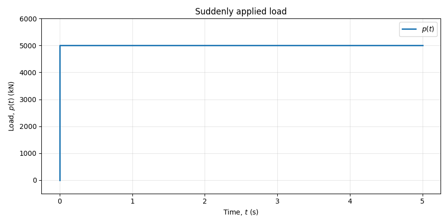
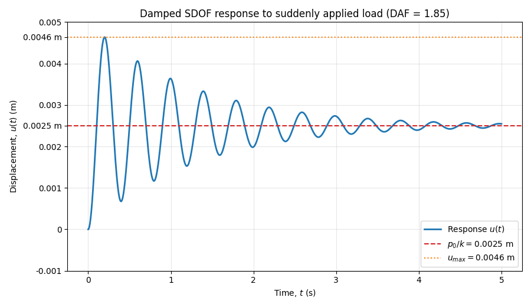

# Damped vibration response of a 1-DOF system subjected to a suddenly applied load

When a single-degree-of-freedom system experiences a suddenly applied load, its motion is shaped by the interplay of mass, stiffness, damping, and the initial conditions. Rather than shifting instantly to the new equilibrium, the system vibrates with oscillations that gradually fade as energy is dissipated through damping. Over time, the motion settles at the static displacement associated with the applied force. This damped vibration response demonstrates how real structures react to sudden excitations in a controlled yet dynamic way. The initial conditions strongly influence the character of the vibration, while the sudden load amplifies displacement beyond what static analysis alone would predict.

<!-- more -->

## Nature of the applied load

The suddenly applied load in structural dynamics has a very specific nature. It is often modeled as a step load — a force that jumps instantly from zero to a constant value at the moment 𝑡 = 0.

<figure markdown="span">
  { width="800" }
  <figcaption>Suddenly applied step load, increasing from zero to p0 = 5000 kN at t=0 and remaining constant thereafter.</figcaption>
</figure>

## General solution

For an underdamped system subjected to a constant load \(p_0\) applied suddenly at \(t=0\), the displacement is

$$
x(t) = e^{-\xi \omega t}
\left[
B_1\cos(\omega_d t) + B_2\sin(\omega_d t)
\right]
+ \frac{p_0}{k}
$$

where

$$
B_1 = x_0 - \frac{p_0}{k}
$$

and

$$
B_2 =
\frac{v_0}{\omega_d}
+
\frac{\xi\omega}{\omega_d}
\left(x_0 - \frac{p_0}{k}\right)
$$

Here, \(x_0\) and \(v_0\) are the displacement and velocity at the instant the load is applied. The undamped natural frequency is \(\omega=\sqrt{k/m}\), and the damped natural frequency is

$$
\omega_d = \omega\sqrt{1-\xi^2}
$$

## Response to the suddenly applied load

<figure markdown="span">
  { width="800" }
  <figcaption>Damped SDOF response to a suddenly applied load</figcaption>
</figure>

The plotted response starts from rest, so the initial conditions are \(x_0=0\) and \(v_0=0\). The load causes the system to oscillate around the static displacement \(p_0/k=0.0025\ \text{m}\). The first peak is approximately \(x_{\max}=0.0046\ \text{m}\), giving a dynamic amplification factor of approximately

$$
\mathrm{DAF}
=
\frac{x_{\max}}{p_0/k}
\approx
\frac{0.0046}{0.0025}
\approx 1.85
$$

The oscillations decrease over time because of damping, and the displacement approaches the static value \(p_0/k\).

## Assumptions

This response assumes a linear single-degree-of-freedom system with constant mass, stiffness, and viscous damping. The load is constant after being applied instantaneously at \(t=0\), and the system is underdamped, so \(0 \leq \xi < 1\). No other forces act on the system after the load is applied. Damping rato $\xi = 0.05$, natural frequency $f_n = 2.5$ Hz, initial displacement $x_0 = 0 \; m$, initial velocity $v_0 = 0 \; m/s$. Mass of the system is $8000$ tonnes and stiffness $2 \cdot 10^9$ N/m.

## References

Hjelmstad, K. D. (2022). Fundamentals of structural dynamics: Theory and computation. Springer.